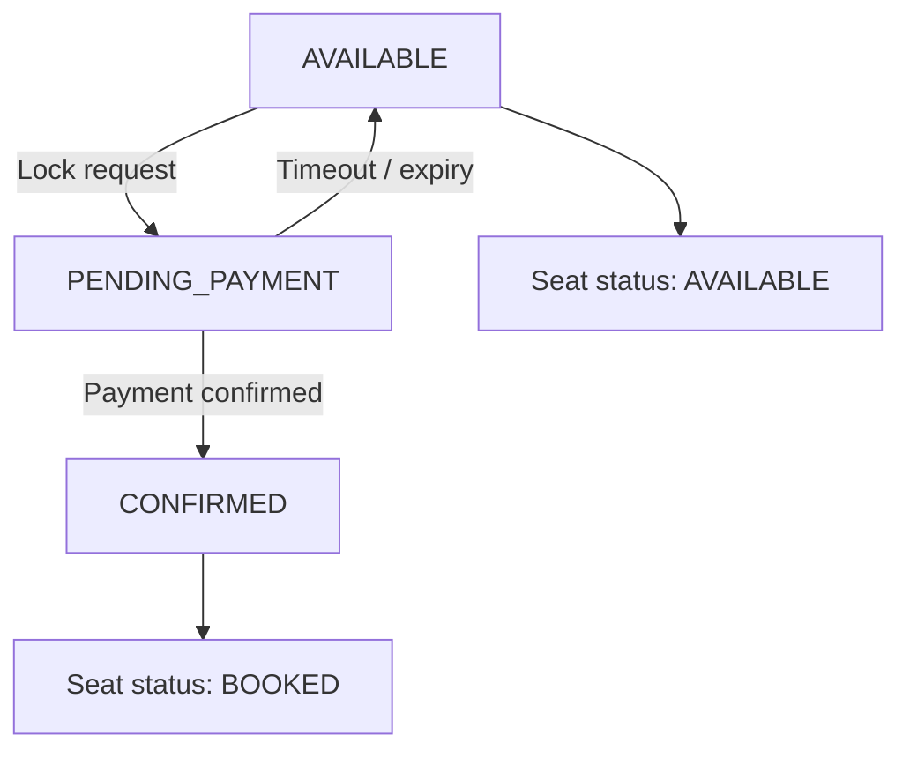

# 🎟️ SeatLock - Concurrent Booking & Reservation Engine

A robust seat booking and reservation management backend system built with **Spring Boot** and **MySQL**. It is designed to handle high concurrency, prevent double-booking race conditions, manage booking lifecycles, and automatically release expired holds via scheduled background tasks.

---

## 📌 Problem Statement

In high-traffic booking platforms (such as event ticketing or railway reservation systems), multiple users may attempt to book the same seat simultaneously. Common challenges include:

- **Race Conditions & Double Bookings:** Multiple users trying to acquire the same seat at the same time.
- **Abandoned Sessions:** Users locking seats for payment but never completing the transaction.
- **Data Inconsistency:** Missing transaction boundaries can cause orphaned records or inconsistent seat and booking states.

---

## 💡 Solution & Architecture

SeatLock addresses these challenges with a multi-layer reservation strategy:

1. **Pessimistic Concurrency Control:** Uses database-level row locking (`PESSIMISTIC_WRITE`) during seat acquisition to serialize simultaneous booking requests for the same seat.
2. **State-Driven Lifecycle Management:** Uses distinct states such as `AVAILABLE`, `PENDING_PAYMENT`, and `CONFIRMED` to track booking progress.
3. **Automated Expiry & Reclamation:** A background `@Scheduled` task periodically identifies expired `PENDING_PAYMENT` bookings and returns their seats to the `AVAILABLE` state.

---

## 🛠️ Tech Stack

- **Language:** Java 21
- **Framework:** Spring Boot (Spring Web, Spring Data JPA)
- **Database:** MySQL
- **Concurrency / Transactions:** `@Transactional`, `PESSIMISTIC_WRITE` locking
- **Background Processing:** Spring `@Scheduled` tasks
- **Build Tool:** Maven

---

## 🔄 Booking Lifecycle & States



- A seat moves from `AVAILABLE` to `PENDING_PAYMENT` when a valid lock request succeeds.
- A successful payment confirmation changes the booking to `CONFIRMED` and the seat to `BOOKED`.
- If the hold expires before confirmation, the booking is marked `EXPIRED` and the seat becomes `AVAILABLE` again.

---

## 🚀 API Endpoints

### 1. Lock a Seat

- **Method:** `POST`
- **URL:** `/api/bookings/lock`
- **Parameters:** `userId` (`Long`), `seatId` (`Long`)
- **Description:** Locks the target seat using pessimistic locking and creates a booking in `PENDING_PAYMENT` state with an expiry timestamp.

### 2. Confirm Booking (Payment Success)

- **Method:** `POST`
- **URL:** `/api/bookings/confirm`
- **Parameters:** `bookingId` (`Long`)
- **Description:** Validates the active pending booking, transitions it to `CONFIRMED`, and marks the seat as `BOOKED`.

---

## ⚙️ Key Technical Highlights

- **Double-Booking Prevention:** Serializes concurrent requests for the same show-seat inventory row using JPA pessimistic locks.
- **ACID Transactions:** Uses `@Transactional` boundaries to maintain consistency and roll back failed operations.
- **Self-Healing Expiry Worker:** A scheduled background task handles expired holds without manual intervention.
- **Persistent Booking History:** Keeps booking lifecycle records for auditability rather than deleting expired or cancelled bookings.

---

## 🧱 Planned Database Model

The database design separates physical seats from show-specific seat availability:

- `users`: user details.
- `shows`: event or show information.
- `seats`: physical seat identifiers.
- `show_seats`: availability and status of each seat for a particular show.
- `bookings`: booking attempts and lifecycle history.

A unique constraint on `(show_id, seat_id)` in `show_seats` ensures there is only one inventory row for a given seat in a given show.

---

## ▶️ Getting Started

### Prerequisites

- Java 21
- MySQL
- IntelliJ IDEA (or another Java IDE)
- Maven (the project includes the Maven Wrapper)

### 1. Create the database

```sql
CREATE DATABASE seatlock_db;
```

Create the required tables using the project's database schema before starting the application.

### 2. Configure database credentials

Set these environment variables in your IDE run configuration or shell:

```text
DB_USERNAME=root
DB_PASSWORD=your_actual_mysql_password
```

The default JDBC URL is:

```text
jdbc:mysql://localhost:3306/seatlock_db
```

Do not commit real database credentials to version control.

### 3. Run the application

On Windows, from the project root:

```powershell
.\mvnw.cmd spring-boot:run
```

On macOS or Linux:

```bash
./mvnw spring-boot:run
```

---

## 🗺️ Project Structure

```text
src/main/java/com/seatlock/
├── SeatLockApplication.java
├── config/
├── controller/
├── dto/
│   ├── request/
│   └── response/
├── entity/
├── exception/
├── repository/
├── scheduler/
└── service/
    └── impl/
```

Packages will be populated as the corresponding features are implemented.

---

## 🧪 Concurrency Testing Goals

- Send simultaneous lock requests for the same show-seat pair.
- Verify that at most one request can hold the seat at a time.
- Verify that a second request is rejected after the first transaction commits the hold.
- Verify that expired holds become available again.
- Verify that an expired booking cannot be confirmed.
- Verify that failed transactions do not leave seat and booking records inconsistent.

---

## 📌 Project Status

**Status:** In development.

This README describes the intended design. API behavior, scheduled expiry, and concurrency guarantees should be verified with implementation and automated tests as the project progresses.
